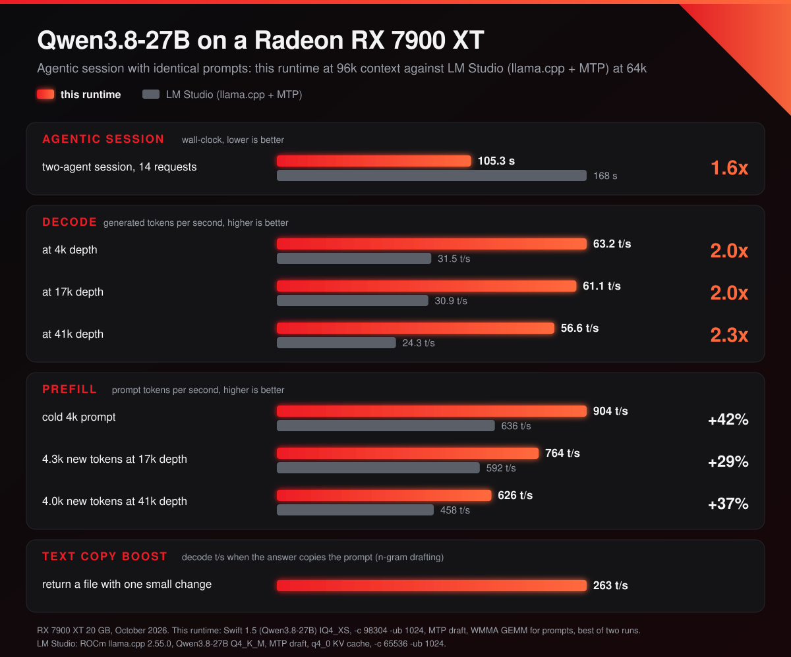

# RDNA-FAST agent server

**Qwen3.8-27B for agents on a Radeon RX 7900 XT / XTX.** A light-speed
`llama-server` runtime for **Qwen3.8-27B on a 20 GB RX 7900 XT**, built for
**agentic work**: long tool-calling sessions, several agents sharing one GPU,
ideal for Hermes. Built on [ROCmFPX](https://github.com/ROCmFPX/ROCmFPX) (its
FP4/FP6 weight formats) and [llama.cpp](https://github.com/ggml-org/llama.cpp).


## Highlights

- **Faster agent loops than LM Studio on the same card.** With the same model,
  quant and context, a scripted two-agent session finishes in 104 s instead of
  132 s. [Numbers](#speed)

- **Multi-token prediction.** The model's own MTP head drafts tokens ahead: up
  to 54 t/s on prose and 88 t/s on code. When an answer repeats text from the
  prompt, as code edits do, n-gram drafting copies it at up to 264 t/s.

- **Prompts on the matrix cores.** Prompt processing runs on RDNA3's WMMA units
  through [rocm_wmma_gemm](https://github.com/adelj88/rocm_wmma_gemm) by Adel
  Johar, for the stock 4-bit quants as well as the ROCmFPX formats.
  [More](#prompts-through-a-wmma-gemm)

- **96k tokens of context on a 20 GB card** with
  [Swift 1.5 IQ4_XS](https://huggingface.co/ukisai/Swift-1.5-Qwen3.8-27B-GGUF/blob/main/Swift-1.5-Qwen3.8-27B-IQ4_XS.gguf),
  UkisAI's Qwen3.8-27B fine-tune, our recommended model. For slightly faster
  prompts, our ROCmFPX-optimised quant of the same model:
  [ROCmFP4-FP6 recipe](docs/rocmfpx/swift-1.5-qwen3.8-27b-rocmfp4-fp6.md)

- **Switching conversations costs seconds, not minutes.** Conversations are
  saved to SSD and restored when they come back, in about 3 s instead of a
  minute or more of re-reading. [More](#the-ssd-prompt-cache)

- **Several agents on one GPU.** Two conversations share one memory pool, so a
  second agent runs beside the first, and an idle one costs nothing.
  [More](#several-slots-on-one-gpu)

- **Shared system prompts.** Conversations that start with the same system
  prompt and tools pick up from the state they share.

- **Survives restarts.** The prompt cache carries over to the next run.

- **Vision** for screenshots and photos.

- **A decision classifier on the same port**: yes/no, choice and score answers
  with calibrated probabilities, from a small model on the CPU.

- **Request priority**, so the most urgent agent goes first. [More](#request-priority)

- **Fails fast when busy.** Requests are turned away once a few are waiting, so
  a client can fall back to another server.

Measured on one machine: RX 7900 XT 20 GB, Ryzen 9 7900, 32 GB RAM,
Windows 11, ROCm 7.2 HIP SDK, one NVMe for models and cache. Nothing here has
been measured on an XTX.

## Speed



Against LM Studio on the same card, with the same model, quant and context: one
scripted two-agent session with identical prompts (14 requests; an orchestrator
grows from 4k to 41k tokens, a 10k-token worker is called twice in between):

| | LM Studio + MTP draft | this runtime |
|---|---:|---:|
| **the session, wall-clock** | **132 s** | **104 s** |
| prefill t/s, cold 4k prompt | 728 | 904 |
| prefill t/s, 4.3k new tokens at 17k depth | 678 | 776 |
| prefill t/s, 4.0k new tokens at 41k depth | 519 | 633 |
| decode t/s at 4k depth | 51.6 | 67.4 |
| decode t/s at 17k depth | 56.6 | 65.1 |
| decode t/s at 41k depth | 42.4 | 56.6 |
| decode t/s, text copy boost: code edit that copies the prompt | unavailable | 264 |

<sub>October 2026. Both run Swift 1.5 IQ4_XS at `-c 98304` with MTP drafting,
flash attention, a q4_0 KV cache and two sessions, the best run for each value
(LM Studio: two runs, this runtime: four). LM Studio is its ROCm llama.cpp
runtime 2.64.0 with batch 2048 / 1024; this runtime runs the quick start below
(`-ub 1024`). The edit row is the text copy boost, n-gram drafting, the best of
six edits; LM Studio cannot run it, as its API does not switch Swift 1.5's
thinking off.</sub>

The same session with each quant we tested:

| quant | size | session, this runtime | session, LM Studio | prefill t/s at 4k / 17k / 41k | decode t/s at 4k / 17k / 41k | code edit t/s |
|---|---:|---:|---:|---:|---:|---:|
| [Q4_K_M](https://huggingface.co/ukisai/Swift-1.5-Qwen3.8-27B-GGUF/blob/main/Swift-1.5-Qwen3.8-27B-Q4_K_M.gguf)\* | 17.4 GB | 146.8 s | 1,211 s (spill) | 408 / 548 / 431 | 50.6 / 50.8 / 48.2 | 238 |
| [Q4_K_S](https://huggingface.co/ukisai/Swift-1.5-Qwen3.8-27B-GGUF/blob/main/Swift-1.5-Qwen3.8-27B-Q4_K_S.gguf) | 16.4 GB | 112.6 s | 1,139 s (spill) | 889 / 769 / 616 | 49.2 / 51.7 / 48.8 | 247 |
| [IQ4_XS](https://huggingface.co/ukisai/Swift-1.5-Qwen3.8-27B-GGUF/blob/main/Swift-1.5-Qwen3.8-27B-IQ4_XS.gguf) | 15.5 GB | 103.8 s | 132.4 s | 904 / 776 / 633 | 67.4 / 65.1 / 56.6 | 264 |
| [ROCmFP4-FP6](docs/rocmfpx/swift-1.5-qwen3.8-27b-rocmfp4-fp6.md) | 16.1 GB | 104.5 s | | 923 / 798 / 634 | 60.2 / 56.4 / 58.5 | 243 |

<sub>\* At 64k (`-c 65536`) and `-ub 512`: the smaller context and prompt
batches keep Q4_K_M's spill into system RAM down while staying above Hermes'
64,000-token minimum. The other quants run at 96k with `-ub 1024`. Prefill and
decode are this runtime's, in the session above; the better of two runs (IQ4_XS:
the best of four, Q4_K_M: one). LM Studio's Q4_K_S and Q4_K_M sit at the edge of
the card's memory and read every prompt again in full. ROCmFP4-FP6 is a ROCmFPX
format, which LM Studio does not load.</sub>

Decode, 450-token answers at temperature 1, the best of nine:

| decode t/s | peak |
|---|---:|
| prose | 54.0 |
| code | 88.2 |
| without MTP, prose or code | 36.8 |

Cold prompts, each followed by a 300-token answer at that depth:

| | 17k | 41k | 69k |
|---|---:|---:|---:|
| prefill t/s, average over the prompt | 875 | 782 | 689 |
| decode t/s at that depth | 51.3 | 49.2 | 43.7 |

## Quick start

**1. Model.**
[`Swift-1.5-Qwen3.8-27B-IQ4_XS`](https://huggingface.co/ukisai/Swift-1.5-Qwen3.8-27B-GGUF/blob/main/Swift-1.5-Qwen3.8-27B-IQ4_XS.gguf)
(15.5 GB): [UkisAI's Swift 1.5](https://huggingface.co/ukisai/Swift-1.5-Qwen3.8-27b),
a Qwen3.8-27B fine-tune, with its MTP head, plus the f16 `mmproj` of the base
model for vision. Against the model's Q8_0 it picks the same top token 93.5% of
the time (mean KL divergence 0.021, wikitext-2).

The ROCmFPX-optimised alternative is our quant of the same model,
`Swift-1.5-Qwen3.8-27B-ROCmFP4-FP6` (16.1 GB): ROCmFP4 weights with 61
sensitive tensors in `Q6_0_ROCMFPX`. Its prompts run 2-5% faster, at 92.8% the
same top token (KL divergence 0.026). The
[recipe and its tensor policy file](docs/rocmfpx/swift-1.5-qwen3.8-27b-rocmfp4-fp6.md)
are in this repository.

**2. Build** (ROCm 7.2 clang, Ninja; about 3 minutes):

```
cmake -S . -B build-hip -G Ninja -DCMAKE_BUILD_TYPE=Release ^
  -DCMAKE_C_COMPILER="%HIP_PATH%bin\clang.exe" -DCMAKE_CXX_COMPILER="%HIP_PATH%bin\clang++.exe" ^
  -DCMAKE_PREFIX_PATH="%HIP_PATH%" -DGGML_HIP=ON -DGPU_TARGETS=gfx1100 -DCMAKE_HIP_ARCHITECTURES=gfx1100 ^
  -DGGML_HIP_GRAPHS=ON -DGGML_HIP_NO_VMM=ON -DGGML_HIP_FORCE_MMQ=ON -DGGML_CUDA_FA_ALL_QUANTS=ON ^
  -DGGML_CUDA_GRAPHS=ON -DGGML_NATIVE=ON -DGGML_OPENMP=ON -DGGML_SCHED_MAX_COPIES=4 ^
  -DLLAMA_BUILD_SERVER=ON -DLLAMA_BUILD_TOOLS=ON -DLLAMA_BUILD_TESTS=OFF -DLLAMA_CURL=OFF ^
  -DLLAMA_BUILD_WEBUI=OFF -DLLAMA_BUILD_UI=OFF -DLLAMA_USE_PREBUILT_UI=OFF
cmake --build build-hip --target llama-server -j 12
```

**3. Run:**

```
set "PATH=%HIP_PATH%bin;%PATH%"
set GGML_CUDA_NO_PINNED=1
set LLAMA_MAX_QUEUED=3
set ROCMFPX_DRAFT_VOCAB=24576
set GGML_HIP_FA_GQA6=1

llama-server -m Swift-1.5-Qwen3.8-27B-IQ4_XS.gguf --mmproj mmproj-Qwen3.8-27B-f16.gguf ^
  -dev ROCm0 -ngl 999 -fa on --jinja --load-mode dio --gpu-keepalive-ms 2000 ^
  -c 98304 -np 2 --kv-unified --kv-unified-reserve 12288 --no-cache-idle-slots ^
  -ctk q4_0 -ctv q4_0 -ctkd q4_0 -ctvd q4_0 -b 2048 -ub 1024 --no-mmproj-offload ^
  --ctx-checkpoints 8 --checkpoint-min-step 2048 ^
  --cache-ram 0 --cache-disk D:\llama-cache --cache-disk-limit 65536 --cache-disk-checkpoints 4 ^
  --spec-type "draft-mtp,ngram-map-k4v" --spec-draft-n-max 4 --spec-draft-p-min 0.60 ^
  --chat-template-kwargs "{\"reasoning_effort\":\"low\"}" ^
  --reasoning-budget 4096 --reasoning-budget-message "I have thought enough, so I will act on my plan now." ^
  --reasoning-preserve --temp 1 --sleep-idle-seconds -1 ^
  --alias qwen/qwen3.8-27b --host 0.0.0.0 --port 1234 --api-key-file api-keys.txt
```

The server speaks the usual OpenAI-compatible API on `/v1`.

Flags:

| flag | why |
|---|---|
| `-c 98304`, `-ctk q4_0 -ctv q4_0` | about what a 20 GB card holds with these settings: 18.1 GB resident, 0.7 GB paged with IQ4_XS (18.6 GB with the ROCmFP4-FP6 quant). KV costs ~18 KB/token. Whatever does not fit, Windows silently pages to system RAM. |
| `-np 2 --kv-unified --kv-unified-reserve 12288` | two slots share one pool instead of splitting it. The reserve admits a second request only while both can still generate 12k tokens, else it waits in the queue. See [Several slots on one GPU](#several-slots-on-one-gpu). |
| `--no-cache-idle-slots` | keeps the idle conversation resident; the default saves and clears it at every new task, which leaves one live conversation. |
| `--no-mmproj-offload` | the 0.9 GB vision projector was the whole paged share at two slots. Images cost 7-12 s to the first token instead of 3-5 s. |
| `-ub 1024` | prefill +6% at 17k and +11% at 41k over 256, for 0.3 GB more VRAM; 512 gives +4% and +8% for 0.1 GB. Decode does not change with it (55.7 against 56.0 t/s on identical text). The WMMA GEMM for prompts takes batches of 512 tokens or more only, so at `-ub 256` it never runs. `-ub 2048` does not fit beside `-c 106496` on 20 GB (2.3 GB paged, prefill falls to 162 t/s); at `-c 65536` it fits but gains only 1-2% on cold prompts (949 / 836 against 932 / 821 t/s at 17k / 41k). |
| `--spec-type draft-mtp`, `--spec-draft-n-max 4` | +45% decode on prose, +112% on code, for about 0.7 GB of VRAM and 3% of prefill speed. The draft head has its own KV cache; for prompt tokens only its K and V are computed, nothing else of the block is ever read. |
| `--spec-type "...,ngram-map-k4v"` | text copy boost: n-gram drafting in front of MTP. Where the last tokens repeat an earlier place of the context, the continuation found there is drafted, otherwise MTP drafts as before. Each match first makes a 4-token probe that is not sent: MTP drafts that pass, and the probe is scored against what comes out. Once six probes in a row would have been accepted in full, n-gram drafts of up to 48 tokens replace MTP until one is not accepted in full, so a match that is only a phrase or a path costs neither a pass nor a checkpoint. On two days of agent traffic (783 requests) this saved 4.6-6.0% of decode time, and 5-6% of the requests came out slower, against 12-40% when the probes were sent. Code edits that copy the prompt run at up to 263 t/s. Quote the value in a .cmd file: cmd splits arguments at commas. |
| `--no-spec-ngram-map-ramp` | not set here. Full-length n-gram drafts (48 tokens) from the first match: 268 t/s on code edits and 180 t/s on the copy at 41k, but slower on answers that only share phrases with the context, where a wrong long draft costs a checkpoint restore and a replay pass. |
| `--ctx-checkpoints 8` | kept in host RAM, ~200 MiB each. When the list is full, the one whose removal leaves the smallest gap is dropped; the one at the first user message never is. |
| `--cache-disk` | conversations and their checkpoints are kept on SSD. See [The SSD prompt cache](#the-ssd-prompt-cache). |
| `--load-mode dio` | the default memory-mapped load keeps the 15 GB model file in system RAM. |
| `--gpu-keepalive-ms 2000` | an idle card on a nearly full VRAM budget loses its resident memory and the next request crawls. |
| `--reasoning-budget 4096` | caps the thinking of one answer. Over the model's first 42 hours of agent traffic (567 calls) the median answer thought 86 tokens and 99% stayed under 4.4k; the cap reaches about 1% of the calls, the long re-planning ones (up to 12.5k tokens, three and a half minutes), and cuts 9% of all thinking. When it runs out, the server forces `--reasoning-budget-message` and the end of thinking, and the model answers. A client can set its own per request with `reasoning_budget_tokens`. |
| `--reasoning-preserve` | with a client that does not echo thinking, every past assistant turn renders as an empty think block (~4 tokens). Without it the template renders the previous turn differently once a new user message arrives, so a tool-using turn was re-prefilled (median 5k tokens) on every exchange. |
| `--temp 1` | Qwen3.8 degrades under greedy decoding. |

Environment variables:

| variable | why |
|---|---|
| `GGML_CUDA_NO_PINNED=1` | pinned host memory makes more of the model page out, for no speed gain. |
| `LLAMA_MAX_QUEUED=3` | a request is rejected once three are already waiting, so a client can fall back to another server instead of queueing. |
| `ROCMFPX_DRAFT_VOCAB=24576` | a drafted token is scored against 24,576 candidate tokens instead of all 248,320: half fixed, half the main model's own top tokens at the previous position, per slot. The main model still verifies each drafted token against the full vocabulary. Measured at 16,384: 0.12 ms instead of 1.9 ms per drafted token, decode +9% on a short context and +3 to 5% at 41k, a verbatim copy drafts slightly less (acceptance 0.99 to 0.96), ordinary text the same. 24,576 accepts 3.50 drafted tokens per verify pass against 3.43 at 16,384, at the same speed. |
| `GGML_HIP_FA_GQA6=1` | attention for decode batches of 1 to 5 tokens: one GPU block per KV head with all six of its query heads, instead of three groups of two and a batch padded to 8. Decode +10 to 12% at 41k, +2 to 6% at 17k, nothing at a short context. Qwen3.5/3.8-27B on RDNA only (head size 256, 24 query heads on 4 KV heads). |
| `ROCMFPX_MTP_LEAN_RESERVE` | not set here, on by default: the MTP draft context reserves memory for the two shapes it runs (the K/V-only pass over prompt tokens and a one-token draft step), 80 MiB instead of 784 MiB, which is what lets `-c 98304` fit. `=0` restores the full reserve. |
| `ROCMFPX_NGRAM_SHADOW`, `ROCMFPX_NGRAM_PROBES` | not set here: `ROCMFPX_NGRAM_SHADOW=0` sends the n-gram probes in place of MTP's draft instead of scoring them in the background, `ROCMFPX_NGRAM_PROBES` sets how many probes in a row must hold before long n-gram drafts start (6). |
| `ROCMFPX_WMMA_GEMM` | not set here, on by default on gfx1100 and gfx1151: prompt-sized FP4/FP6 products through the WMMA GEMM. `=0` turns it off. See [Prompts through a WMMA GEMM](#prompts-through-a-wmma-gemm). |
| `ROCMFPX_WMMA_GEMM_MIN_BATCH`, `ROCMFPX_WMMA_GEMM_SCRATCH_MB` | not set here: the smallest batch that takes the WMMA GEMM (512) and the size of its f16 weight scratch (64 MB). |

## Other cards

Everything above is tuned and measured on an RX 7900 XT. The project still runs
elsewhere; the card-specific fast paths are gated so that other hardware keeps
the stock behaviour.

- **Any backend (CPU, Vulkan, other GPUs).** The slot ranges on the shared
  pool, the shared pass of busy slots, the MTP changes, the draft vocabulary,
  the graph arenas and the SSD prompt cache live in the model core and the
  server and do not depend on the GPU. The tree builds with gcc and the Vulkan
  backend (checked on 10 October 2026).
- **AMD cards with HIP.** The GPU backend builds for the gfx11 targets: RDNA3
  (RX 7000 series) and RDNA3.5 (gfx1151, checked on 10 October 2026). Since
  the merge of ROCmFPX main on 19 October 2026 it also builds for RDNA4
  (gfx1201, checked by the ROCmFPX project), where the ROCmFPX weight types
  use the RDNA3 matmul tiles. RDNA2 targets have not been checked again.
- **Fast paths for the RX 7900 series.**
  - Attention that reads a q4_0 KV cache directly is on by default for RDNA3
    desktop cards (RX 7900, 7800, 7700, 7600) and RDNA4 (RX 9000, AI PRO
    R9700); it was measured on the RX 7900 XT only. `GGML_HIP_FA_Q4_TILE=1`
    turns it on for any HIP card, `=0` turns it off everywhere.
  - `GGML_HIP_FA_GQA6=1` (six query heads per attention block) is opt-in and
    runs on RDNA cards only. Its thread layouts and block counts were tuned on
    gfx1100.
  - The WMMA GEMM for prompts is built and used only for gfx1100 (RX 7900 XT,
    XTX, GRE) and gfx1151, the targets its configurations are tuned for; every
    other card keeps the int8 path.
- **Settings.** `-c`, `-ub 1024` and the VRAM split in this README are sized
  for 20 GB of VRAM. The speed tables are for the RX 7900 XT and will differ on
  other cards.

## Prompts through a WMMA GEMM

Prompt processing is mostly matrix products of the FP4 weights: 62-72% of a
1,024-token batch at 0-41k depth, attention takes most of the rest. The int8
path (weights unpacked to int8, activations quantized to 8 bits, int8 WMMA)
does 40-44 TFLOPS on the model's shapes; an FP16 WMMA GEMM tuned for RDNA3
does 76-92 on the same shapes. So for batches of 512 tokens or more, the weight
rows are unpacked to f16 in chunks into a 64 MB scratch, the activations are
converted to f16, and [rocm_wmma_gemm](https://github.com/adelj88/rocm_wmma_gemm)
(Adel Johar, MIT, in `vendor/rocm_wmma_gemm`) computes the product with f32
accumulation.

| one matrix product | int8 path | WMMA GEMM |
|---|---:|---:|
| FP4 weights, the four shapes of the model, 1,024 tokens | 41-45 TFLOPS | 60-62 TFLOPS |
| FP6 weights, 1,024 tokens | 29-31 TFLOPS | 51-52 TFLOPS |
| stock quants (Q4_0, Q4_K, Q5_K, Q6_K, IQ4_NL, IQ4_XS), 512 tokens | 39-48 TFLOPS | 45-48 TFLOPS |

With Swift 1.5 IQ4_XS, a cold 17k prompt runs at 864 t/s through the WMMA GEMM
and at 781 t/s on the int8 path.

On the model, cold prompts go from 682 to 923 t/s at 17k and from 621 to 815
t/s at 41k. Decode does not change (the same text at temperature 0: 56.1 and
58.6 t/s at 17k). The scratch costs 0.24 GB of VRAM and nothing more is paged.
f16 activations are more precise than the 8-bit ones of the int8 path; the
needle test, the two-slot test and 118 of 118 matrix product tests against the
CPU pass. Quality is unchanged: wikitext-2 perplexity 6.5080 with it and
6.5077 without (Swift 1.5, `-c 2048 -ub 1024`), and against the int8 path a
mean KL divergence of 0.0024 with the same top token 99.0% of the time.
Below 512 tokens the unpacking costs about what the GEMM saves, so
smaller batches stay on the int8 path.

The build makes one library per GPU architecture, `rocm_wmma_gemm_<arch>_accf32`,
next to the other binaries (`ggml/src/ggml-hip/wmma-gemm.cmake`; Python 3 is
needed at configure time to generate its kernels, `-DGGML_HIP_WMMA_GEMM=OFF`
skips it). Without that library the int8 path runs as before. The gfx1100
configuration adds entries for this model's products at 1,024 and 2,048 rows,
tuned with the library's own tuner; against the closest upstream entries they
move prefill by 3% or less.

## The SSD prompt cache

Qwen3.8 is a hybrid (16 attention + 49 recurrent layers), and recurrent state
cannot be rolled back to an arbitrary prefix, so stock llama.cpp re-prefills a
conversation from scratch once another request has taken its slot. Here the
conversation is written to SSD together with its checkpoints and restored when
it returns:

| situation | stock | this runtime, median (range) |
|---|---|---|
| return to a 40-53k-token conversation after another agent used the slot | 77-105 s | **2.9 s** (1.5-7.3) |
| new session with the same 12-24k system prompt + tools | 20-42 s | **0.7 s** (0.4-25) |
| prompt diverges from the cached one before its end, 25-34k | 45-62 s | 7.5 s (6.5-10) |
| first request after a server restart, 18-27k | 30-50 s | 4.2 s (1.0-10.9) |

Off unless `--cache-disk` is given. Everything else has a working default.

| flag | default | meaning |
|---|---|---|
| `--cache-disk PATH` | off | cache directory. Put it on an NVMe. |
| `--cache-disk-limit N` | 8192 | size limit in MiB; least recently used entries go first. A 16k-token entry is ~0.65 GB with one checkpoint, a 45k-token one ~1.8 GB with four. |
| `--cache-disk-checkpoints N` | -1 (all) | checkpoints written with each entry, newest first. More let a prompt that diverges mid-history resume closer to the divergence. |
| `--cache-disk-prefix-step N` | 4096 | spacing of the shared system-prompt entries; 0 disables them. |
| `--cache-disk-min-tokens N` | 2048 | shorter prompts (keep-alive pings, title requests) are never written. |

Each flag also reads `LLAMA_ARG_CACHE_DISK[_...]` from the environment.

- **The cache directory must not be NTFS-compressed** (fix with
  `compact /U /S:<dir>`): compression caps an NVMe at ~140 MB/s, against
  ~1.4 GB/s without (a 1.8 GB entry saves in 1.3 s and restores in 0.8 s).
- **Age-based cleanup of the directory is safe.** The server refreshes a
  file's timestamp whenever it uses it.
- **Make the agent rewrite history as little as possible.** Every rewrite is a
  cache break: set its compaction trigger well below the context size.
  Auxiliary calls (titles, summaries, vision) take the slot too; the cache
  makes that cheap, not free.

## Request priority

Every request can carry `"priority"` in its body, so the agent you are talking
to does not wait behind background work. A request without it is `default`.

| `"priority"` | waiting for a slot | while it runs |
|---|---|---|
| `low` | behind everything else | always leaves one slot free: it starts only while another slot stays idle (with one slot it simply waits its turn) |
| `default` | ahead of `low` | shares the card with whatever else runs |
| `high` | ahead of `default` and `low` | shares the card with whatever else runs |
| `xhigh` | at the front | requests of a lower level are held until it is done |

A held request keeps its slot, its context and its connection. If it is
generating it still joins one pass every 2 s (`--priority-trickle-ms`, shared
by all held requests, `0` = none), so its client keeps seeing progress; if it
is still reading its prompt it waits. Nothing is cancelled or restarted. With
`LLAMA_MAX_QUEUED`, waiting requests of a lower level do not count against a
new one.

On the RX 7900 XT with the 27B model, an `xhigh` request generated at 49.7 t/s
beside a held one, against 48.6 t/s alone; the held one advanced by about one
token per second for those 16 s and then continued at full speed. Without a
draft model a held request ends with exactly the text of an undisturbed run at
temperature 0; with MTP drafting the two can part late, as any two runs with a
different draft pattern can.

With an agent framework, set it per agent, e.g. in Hermes through
`extra_body: {priority: xhigh}` in the provider entry of the agent you talk
to. Tested with 1 to 4 slots on a small model and with 2 slots on the 27B
model: queue order, the free slot, hold and trickle.

## Decision classifier

`POST /v1/classifier` answers typed `choice`, `noul` (yes/no) and `score`
questions about a text with calibrated probabilities instead of generated
text, from an open decision model such as StartLux-Decision. Start a server
with that model and `--classifier-config`, or run it as a child of a router
(`--models-preset`) next to the big model: one port, one API key, both models.
On the CPU (`-dev none -ngl 0`) StartLux-Decision-2B BF16 answers a yes/no
question in 0.4 s. Details: [docs/classifier.md](docs/classifier.md).

## Several slots on one GPU

`-np 2 --kv-unified` gives two agents a slot each on one shared KV pool, so an
orchestrator's chat turn does not wait behind a worker's long run. More agents
than slots is what the [SSD prompt cache](#the-ssd-prompt-cache) is for.

- **Admission.** With `--kv-unified-reserve 12288` a request starts beside a
  running one only while both keep 12k tokens of generation room, otherwise it
  queues. A conversation that has to give up its cells is saved to SSD first.
  Without the reserve a full pool fails both requests and wipes both contexts.
- **Slot ranges.** Each slot keeps its cells in its own range of the pool (with
  more than two slots, two per region) and attention runs over that range
  only, so an idle conversation costs the active one nothing.
- **Shared pass.** Slots that decode at the same moment go through the model
  in one pass. On by default; `--no-shared-pass` gives every slot its own pass
  again.

One slot idle with a 41k-token conversation in it. Stock llama.cpp computes
attention over every occupied cell of the shared cache:

| the active slot | other slot empty | stock, other slot holds 41k | this runtime, other slot holds 41k |
|---|---:|---:|---:|
| shallow decode t/s | 48 | 31 | 49 |
| cold 17k prefill t/s | 611 | 369 | 608 |
| decode t/s at 17k depth | 50 | 36 | 51 |

Both slots busy. Slots that decode at the same moment share the pass over the
model: their tokens form one batch of up to 8, the weights are read once, and
attention still runs per slot over its own range. The draft heads draft in
step while both are busy (at most 3 tokens ahead instead of 4), so that both
slots bring batches of the same length. With a pass per slot a loop with both
decoding took 84 ms, exactly two single-slot loops; shared it takes 44 ms.

| both slots busy | a pass per slot (`--no-shared-pass`) | shared pass |
|---|---:|---:|
| both decoding: each slot, t/s | 24.9 and 23.9 | 35.1 and 34.6 |
| both decoding: total t/s | 46.0 | 66.7 |
| one slot alone, t/s | 54.0 | 54.8 |
| one prefills a cold 17k prompt: its prefill t/s | 672 | 668 |
| ... and the other slot's decode t/s meanwhile | 10.1 | 10.3 |

The logits of a shared pass are the same, bit for bit, as those of each slot
decoded in a pass of its own (checked on the GPU for 1 to 4 tokens per slot,
with and without rejected draft tokens; `tests/test-rocmfpx-seq-parity.cpp`
is the CPU version of that check). A prefilling slot still takes passes of its
own, which is why the slot beside a cold prefill waits. Both conversations
stay warm.

The same conversation does not produce bit-identical logits in slot 0 and in
slot 1: the second slot fills its range from the top of the pool downwards,
attention sums its cells in another order, and the last bits differ. With a
4-bit KV cache that grows to 0.1 to 0.3 in the log-probabilities of the ten
most likely tokens, about what the tile and the vector attention kernel
differ by on one and the same slot (0.08 to 0.16).

---

# ROCmFPX llama.cpp

This public downstream tracks current upstream `llama.cpp` while
developing the ROCmFPX weight-format family for AMD GPUs. Normal Vulkan support
remains enabled; HIP and CPU are also supported build targets. Existing NVFP4
GGUF tensors can be loaded natively and remain bit-exact when an NVFP4 model is
completed with the `NVFP4` quantization preset.

Carlo Pasquale (Charlie12345) is the creator and founder of the ROCmFPX format
family and of ROCmFP3, ROCmFP4, ROCmFP6, and ROCmFP8. See
[ROCmFPX documentation](docs/rocmfpx/README.md), [NOTICE](NOTICE), and the
same upstream [MIT license terms](LICENSE) with the ROCmFPX copyright line.

## Contributors and history

ROCmFPX preserves the upstream `llama.cpp` lineage and the public legacy
ROCmFPX lineage. Original commit authors and commit IDs remain reachable. The
legacy lineage is connected by an ancestry-only merge whose source tree is
identical to the current ROCmFPX tree, so legacy code does not replace the
current implementation.

- [Current ROCmFPX contributors](https://github.com/ROCmFPX/ROCmFPX/graphs/contributors)
- [Legacy ROCmFPX contributors](https://github.com/charlie12345/ROCmFPX/graphs/contributors)
- [Upstream llama.cpp contributors](https://github.com/ggml-org/llama.cpp/graphs/contributors)

GitHub contributor displays can lag behind repository history. The complete
commit-level author record is also available with `git shortlog -sne main`.

The currently qualified formats are experimental. The on-disk layouts of
ROCmFP2/3/4/6/8 are frozen for compatibility; new kernel and quantizer work
must preserve their encoded sizes and semantics.

### ROCmFP2 tensor type identity

Canonical dual-scale S40 ROCmFP2 uses GGUF tensor type **111**. Its payload is
still exactly 10 bytes per 32 weights (2.5 bpw); only the tensor type tag moved.
Legacy type 107 is reserved as ambiguous because both dual-scale S40 and an
affine `code * scale - offset` layout were emitted with that same ID and block
size. ROCmFPX refuses type 107 instead of guessing and silently corrupting a
model.

New quantizations write type 111 automatically. To audit an older file, run:

```bash
scripts/rocmfpx/retag-legacy-rocmfp2.py MODEL.gguf
```

Only when the file's provenance confirms that it uses dual-scale S40, make a
backup and retag its tensor headers in place:

```bash
scripts/rocmfpx/retag-legacy-rocmfp2.py MODEL.gguf \
  --layout s40-dual-scale-v1 --apply
```

The tool does not inspect or infer the layout because the two interpretations
cannot be distinguished from the bytes. Do not use it on affine ROCmFP2 files.

## Optional Charlie Vulkan plugin

The optional [`ROCmFPXVulkan` extension](extensions/rocmfpx-vulkan/README.md)
preserves the proven Charlie-era ROCmFP4 Vulkan path as a separate backend. It
does not replace or patch llama.cpp's normal `Vulkan0` backend. The extension
is disabled by default and appears as `ROCmFPXVulkan0` only when it is built
and explicitly loaded.

Build both the normal Vulkan backend and the optional extension on Linux:

```bash
cmake -S . -B build-rocmfpx-vulkan -G Ninja \
  -DCMAKE_BUILD_TYPE=Release \
  -DBUILD_SHARED_LIBS=ON \
  -DGGML_VULKAN=ON \
  -DROCMFPX_VULKAN_PLUGIN=ON
cmake --build build-rocmfpx-vulkan \
  --target llama-cli rocmfpx-vulkan-plugin -j
```

Load the plugin and select its device:

```bash
export ROCMFPX_PLUGIN_PATH="$PWD/build-rocmfpx-vulkan/bin/rocmfpx-vulkan-plugin.so"
build-rocmfpx-vulkan/bin/llama-cli --list-devices
build-rocmfpx-vulkan/bin/llama-cli \
  -m /absolute/path/to/model.gguf \
  -dev ROCmFPXVulkan0 -ngl 999
```

Keep `rocmfpx-vulkan-plugin.so` and its sibling
`libggml-rocmfpx-vulkan.so` together. Both files must come from the same build
and ROCmFPX commit. `--list-devices` should show both `Vulkan0` and
`ROCmFPXVulkan0`; remove `ROCMFPX_PLUGIN_PATH` to return to the normal backend.
See the [extension guide](extensions/rocmfpx-vulkan/README.md) for matched
ROCmFP4 benchmarks and qualification limits.

## Plugin system

ROCmFPX plugin ABI v1 lets trusted native shared libraries register a standard
ggml backend or receive model-open and model-close notifications for PLE, KV
checkpoint, repack-cache, and expert-streaming sidecars. Set
`ROCMFPX_PLUGIN_PATH` to a plugin file or directory before starting a ROCmFPX
tool. Use `:` between entries on Linux and macOS and `;` on Windows. Directories
are scanned once, non-recursively, in sorted order; the working directory is
never searched automatically.

A minimal C plugin looks like this:

```c
#define ROCMFPX_PLUGIN_BUILD
#include "rocmfpx-plugin.h"

static int on_load(void) {
    return 0;
}

static const struct rocmfpx_plugin_v1 plugin = {
    ROCMFPX_PLUGIN_ABI_VERSION,
    sizeof(struct rocmfpx_plugin_v1),
    "example-sidecar",
    "0.1.0",
    ROCMFPX_PLUGIN_CAP_SIDECAR,
    on_load,
    0,
    0,
    0,
};

ROCMFPX_PLUGIN_EXPORT const struct rocmfpx_plugin_v1 * rocmfpx_plugin_query(
        uint32_t host_abi_version,
        const struct rocmfpx_plugin_host_v1 * host) {
    if (host_abi_version != ROCMFPX_PLUGIN_ABI_VERSION || !host ||
        host->abi_version != ROCMFPX_PLUGIN_ABI_VERSION) {
        return 0;
    }
    return &plugin;
}
```

Build and load it on Linux:

```bash
cc -shared -fPIC -I/path/to/ROCmFPX/include \
  example-sidecar.c -o example-sidecar.so
ROCMFPX_PLUGIN_PATH="$PWD/example-sidecar.so" \
  /path/to/ROCmFPX/build/bin/llama-cli --list-devices
```

Every plugin must export `rocmfpx_plugin_query`, validate the ABI, return a
static size-versioned descriptor, and keep that descriptor and its strings
alive until unload. A backend plugin copies `backend_load` and `plugin_path`
during the query, then registers its matching ggml backend from `on_load`. A
sidecar uses `on_model_open` and `on_model_close` and keys its state by
`model_id`. ABI v1 provides discovery, backend registration, and lifecycle
notifications; capability flags alone do not intercept tensors or token
generation. Plugins run as native code with the same permissions as ROCmFPX,
so load only libraries you trust. See the complete [plugin and sidecar ABI
guide](docs/rocmfpx/PLUGINS.md) and the tested
[`rocmfpx-test-plugin`](tests/rocmfpx-test-plugin.c) example.

## Windows AMD multi-GPU bridge

Windows users with two AMD GPUs can evaluate Charlie12345's external
[Windows AMD Multi-GPU Bridge](https://github.com/charlie12345/windows-amd-vllm-multigpu).
For ROCmFPX and llama.cpp, use its dedicated
[Windows installation guide](https://github.com/charlie12345/windows-amd-vllm-multigpu/blob/main/docs/install-llama-rocmfpx.md),
not the separate vLLM adapter instructions.

The bridge keeps the ROCmFPX source tree unchanged. It supplies an external
`roc::rccl` CMake package to the existing HIP collective interface, so build
ROCmFPX with `GGML_HIP_RCCL=ON`, point `rccl_DIR` at the installed bridge, and
use the bridge's `run-with-llama-plugin.ps1` launcher. The tested Windows path
also requires `GGML_CUDA_NO_PEER_COPY=ON`; follow the external guide for the
matching ROCm version, GPU target, DLL layout, health probes, and model-specific
launch flags.

Despite the launcher's name, this transport is **not** loaded through
`ROCMFPX_PLUGIN_PATH` and is not a ROCmFPX ABI v1 plugin. ABI v1 can register a
ggml backend or receive model lifecycle notifications, but it cannot inject a
link-time RCCL provider or intercept collectives. Pointing
`ROCMFPX_PLUGIN_PATH` at `rccl.dll` will therefore do nothing. The current
external-package design is the upstream-safe integration: update ROCmFPX
normally, then configure a fresh HIP build against the bridge package.

The bridge is experimental, source-only, and currently qualified only on the
hardware and revisions listed by its maintainers. Validate its small parity
and transport probes before loading a large model; a selectable GPU target is
not the same as a runtime-qualified configuration.

---

# llama.cpp


<div align="center">

<b>LLM inference in C/C++</b>

[](https://opensource.org/licenses/MIT)
[](https://github.com/ggml-org/llama.cpp/releases?q=tag:v0)
[](https://github.com/ggml-org/llama.cpp/releases?q=b)
[](https://github.com/ggml-org/llama.cpp/actions/workflows/server.yml)
[](https://github.com/ggml-org/llama.cpp/actions/workflows/docker.yml)
[](https://github.com/ggml-org/llama.cpp/actions/workflows/winget.yml)

[ggml](https://github.com/ggml-org/ggml) / [ops](https://github.com/ggml-org/llama.cpp/blob/master/docs/ops.md) / [maintainer PRs](https://github.com/ggml-org/llama.cpp/issues?q=is%3Apr%20is%3Aopen%20draft%3AFalse%20(author%3Argerganov%20OR%20author%3AKitaitiMakoto%20OR%20author%3Adanbev%20OR%20author%3Aaldehir%20OR%20author%3Amax-krasnyansky%20OR%20author%3ACISC%20OR%20author%3Aggerganov%20OR%20author%3Aam17an%20OR%20author%3Ajhen0409%20OR%20author%3Abartowski1182%20OR%20author%3Anikwen%20OR%20author%3Ahipudding%20OR%20author%3Aravi9%20OR%20author%3AServeurpersoCom%20OR%20author%3Apwilkin%20OR%20author%3Areeselevine%20OR%20author%3Angxson%20OR%20author%3Ajeffbolznv%20OR%20author%3Amarty1885%20OR%20author%3A0cc4m%20OR%20author%3ATitaniumtown%20OR%20author%3Aangt%20OR%20author%3AIMbackK%20OR%20author%3Aarthw%20OR%20author%3AJohannesGaessler%20OR%20author%3AORippler%20OR%20author%3Aruixiang63%20OR%20author%3Axctan%20OR%20author%3Aallozaur%20OR%20author%3Ayomaytk%20OR%20author%3Aaendk%20OR%20author%3Awine99%20OR%20author%3Agaugarg-nv%20OR%20author%3Ataronaeo%20OR%20author%3Aforforever73%20OR%20author%3Alhez%20OR%20author%3Anetrunnereve%20OR%20author%3Afairydreaming)%20sort%3Aupdated-desc) / [dev stats](https://github.com/ggml-org/llama.cpp-dev) / [lib llama API](https://github.com/ggml-org/llama.cpp/issues/9289) / [llama-server REST API](https://github.com/ggml-org/llama.cpp/issues/9291)

</div>

## Quick start

A few options to get `llama.cpp` installed on your machine:

```bash
# curl
curl -LsSf https://llama.app/install.sh | sh

# powershell
irm https://llama.app/install.ps1 | iex
```

- Visit https://llama.app and follow the instructions
- Run with Docker - see our [Docker documentation](docs/docker.md)
- Download pre-built binaries from the [releases page](https://github.com/ggml-org/llama.cpp/releases)
- Build from source by cloning this repository - check out [our build guide](docs/build.md)

Once installed:

```sh
# Download and run a model directly from Hugging Face
llama cli -hf ggml-org/Qwen3.5-0.8B-GGUF

# Launch OpenAI-compatible API server
llama serve -hf ggml-org/Qwen3.5-0.8B-GGUF
```

<table align="center">
    <tr>
        <td align="center" width=50%>
            
            <i>VLM session with <b>llama cli</b></i>
        </td>
        <td align="center">
            
            <i>Built-in web UI against <b>llama serve</b></i>
        </td>
    </tr>
<table>

## Description

The main goal of `llama.cpp` is to enable LLM (and VLM) inference with minimal setup and state-of-the-art performance on
a wide range of hardware - locally and in the cloud.

- Plain C/C++ implementation without any dependencies
- Apple silicon is a first-class citizen - optimized via ARM NEON, Accelerate and Metal frameworks
- AVX, AVX2, AVX512 and AMX support for x86 architectures
- RVV, ZVFH, ZFH, ZICBOP and ZIHINTPAUSE support for RISC-V architectures
- 1.5-bit, 2-bit, 3-bit, 4-bit, 5-bit, 6-bit, and 8-bit integer quantization for faster inference and reduced memory use
- Custom CUDA kernels for running LLMs on NVIDIA GPUs (support for AMD GPUs via HIP and Moore Threads GPUs via MUSA)
- Vulkan and SYCL backend support
- CPU+GPU hybrid inference to partially accelerate models larger than the total VRAM capacity

The `llama.cpp` project is build on top of the [ggml](https://github.com/ggml-org/ggml) library.

## Supported backends

| Backend | Target devices |
| --- | --- |
| [BLAS](docs/build.md#blas-build) | All |
| [BLIS](docs/backend/BLIS.md) | All |
| [CANN](docs/build.md#cann) | Ascend NPU |
| [CUDA](docs/build.md#cuda) | Nvidia GPU |
| [HIP](docs/build.md#hip) | AMD GPU |
| [Hexagon](docs/backend/snapdragon/README.md) | Snapdragon |
| [IBM zDNN](docs/backend/zDNN.md) | IBM Z & LinuxONE |
| [MUSA](docs/build.md#musa) | Moore Threads GPU |
| [Metal](docs/build.md#metal-build) | Apple Silicon |
| [OpenCL](docs/backend/OPENCL.md) | Adreno GPU |
| [OpenVINO [In Progress]](docs/backend/OPENVINO.md) | Intel CPUs, GPUs, and NPUs |
| [RPC](https://github.com/ggml-org/llama.cpp/tree/master/tools/rpc) | All |
| [SYCL](docs/backend/SYCL.md) | Intel GPU |
| [VirtGPU](docs/backend/VirtGPU.md) | VirtGPU APIR |
| [Vulkan](docs/build.md#vulkan) | GPU |
| [WebGPU](docs/build.md#webgpu) | All |
| [ZenDNN](docs/build.md#zendnn) | AMD CPU |

## Documentation

#### Tools

- [cli](tools/cli/README.md)
- [completion](tools/completion/README.md)
- [server](tools/server/README.md)
- [GBNF grammars](grammars/README.md)

#### Development

- [How to build](docs/build.md)
- [Running on Docker](docs/docker.md)
- [Build on Android](docs/android.md)
- [Multi-GPU usage](docs/multi-gpu.md)
- [Performance troubleshooting](docs/development/token_generation_performance_tips.md)
- [GGML tips & tricks](https://github.com/ggml-org/llama.cpp/wiki/GGML-Tips-&-Tricks)
- [XCFramework](docs/xcframework.md)
- [Completions](docs/completions.md)
- [Models](docs/models.md)
- [Release process](docs/release.md)

## Contributing

- Contributors can open PRs
- Collaborators will be invited based on contributions
- Maintainers can push to branches in the `llama.cpp` repo and merge PRs into the `master` branch
- Any help with managing issues, PRs and projects is very appreciated!
- Read the [CONTRIBUTING.md](CONTRIBUTING.md) for more information

## Acknowledgements

- [yhirose/cpp-httplib](https://github.com/yhirose/cpp-httplib) - Single-header HTTP server, used by `llama-server` - MIT license
- [nothings/stb](https://github.com/nothings/stb) - Single-header image format decoder, used by multimodal subsystem - Public domain
- [nlohmann/json](https://github.com/nlohmann/json) - Single-header JSON library, used by various tools/examples - MIT License
- [mackron/miniaudio](https://github.com/mackron/miniaudio) - Single-header audio format decoder, used by multimodal subsystem - Public domain
- [sheredom/subprocess.h](https://github.com/sheredom/subprocess.h) - Single-header process launching solution for C and C++ - Public domain
- [adelj88/rocm_wmma_gemm](https://github.com/adelj88/rocm_wmma_gemm) - WMMA GEMM for RDNA3/RDNA3.5, used for prompt-sized FP4/FP6 matrix products on gfx1100 and gfx1151 - MIT license
