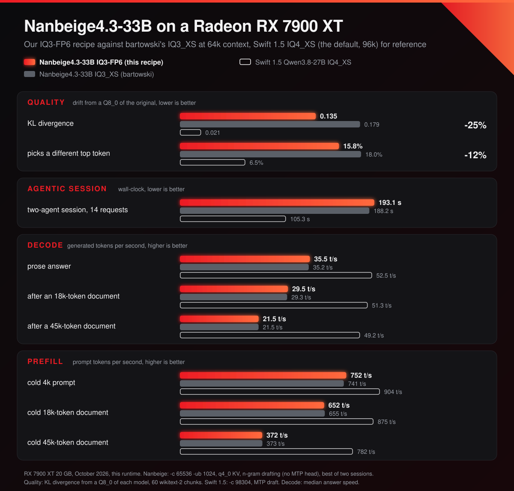

# Nanbeige4.3-33B IQ3-FP6

A 3-bit quantization of
[Nanbeige4.3-33B](https://huggingface.co/Nanbeige/Nanbeige4.3-33B)
(Nanbeige's dense 33B agentic model, Apache-2.0) for the 20 GB RX 7900 XT at
64k context, the least Hermes accepts. The bulk is `IQ3_S`; every `ffn_down`,
every `attn_output` and the first and last four layers' FFN are `IQ4_XS`;
`attn_k`, `attn_v` and `output` are `Q6_0_ROCMFPX`; the embedding is `Q8_0`.
Against bartowski's IQ3_XS of the same model it drifts 25% less from the
original (KL divergence 0.135 against 0.179) at the same speed.



Why 3 bits and 64k: the model is dense, so all 52 layers keep their keys and
values, about 62 KB per token with a q4_0 cache (Qwen3.8-27B, which attends in
16 of its layers: 18 KB). 64k tokens take 3.9 GB, and a 4-bit file (IQ4_XS,
18.6 GB) leaves no room for them. The model has no MTP head and no vision.

## Lane

- Public name: `Nanbeige4.3-33B-IQ3-FP6`
- Policy: `IQ3_S` bulk, `IQ4_XS` and `Q6_0_ROCMFPX` promotions, `Q8_0` embedding
- Tensor policy file: [`nanbeige4.3-33b-iq3-fp6.tensor-types.txt`](nanbeige4.3-33b-iq3-fp6.tensor-types.txt)
- Tensor inventory: 105 F32, 140 `IQ3_S`, 120 `IQ4_XS`, 105 `Q6_0_ROCMFPX`, 1 `Q8_0` (471 total)
- Size: 17,106,078,848 bytes (15.93 GiB), 4.13 BPW over the quantized tensors;
  15.8 GB of it on the GPU (the embedding stays in system RAM)
- Loads only in ROCmFPX builds: `Q6_0_ROCMFPX` does not exist in stock
  `llama.cpp`.

| tensors | type | layers |
| --- | --- | --- |
| `token_embd` | `Q8_0` | |
| `output` | `Q6_0_ROCMFPX` | |
| `attn_k`, `attn_v` | `Q6_0_ROCMFPX` | all 52 |
| `attn_output` | `IQ4_XS` | all 52 |
| `attn_q` | `IQ3_S` | all 52 |
| `ffn_down` | `IQ4_XS` | all 52 |
| `ffn_gate`, `ffn_up` | `IQ4_XS` | 0-3, 48-51 |
| `ffn_gate`, `ffn_up` | `IQ3_S` | 4-47 |

Why this shape: the card holds about 19.4 GB for the server at 64k before
Windows pages part of it to system RAM, and on this model the part that moves
is the prompt buffer: 0.4 GB paged out made prompts five times slower. Within
that budget the bits went where each KL divergence measurement showed the most
quality per gigabyte: `ffn_down` first, then the first and last layers (their
inputs carry outlier channels of 3,000-22,000 times the mean in the importance
matrix), then attention output, keys and values. The embedding costs no VRAM
(llama.cpp keeps it in host memory), so it is `Q8_0`. Keys, values and output
are `Q6_0_ROCMFPX`, 6.5 bits on the fast FP6 path. The ROCmFPX 4- and 3-bit
types are not used: as the bulk format of this model they measured 0.11-0.22
KL divergence ([Harsha001](https://huggingface.co/Harsha001/Nanbeige4.3-33B-ROCmFPX)),
further from the original than the imatrix IQ codebooks.

## Reproduction

Source: the BF16 GGUF (two shards, 61.7 GiB) and the importance matrix
(`Nanbeige_Nanbeige4.3-33B-imatrix.gguf`, calibration-v6 corpus) from
[`bartowski/Nanbeige_Nanbeige4.3-33B-GGUF`](https://huggingface.co/bartowski/Nanbeige_Nanbeige4.3-33B-GGUF).
Pass the first shard; the second is found automatically.

```bash
llama-quantize \
  --imatrix Nanbeige_Nanbeige4.3-33B-imatrix.gguf \
  --tensor-type-file docs/rocmfpx/nanbeige4.3-33b-iq3-fp6.tensor-types.txt \
  Nanbeige_Nanbeige4.3-33B-bf16-00001-of-00002.gguf \
  Nanbeige4.3-33B-IQ3-FP6.gguf \
  IQ3_S 12
```

About 10 minutes on a 12-core CPU; the GPU is not used. Add `--dry-run` first:
it must report `quant size = 16309.81 MiB (4.13 BPW)`. The policy file pins
every quantized tensor.

Serve it like the quick start in the main README, with these differences:
`-c 65536 -ub 512` and no MTP draft (`--spec-type ngram-map-k4v`; the model has
no MTP head), no `--mmproj`, and the model card's sampling (`--temp 0.6 --top-p
0.95`). `-ub 512` halves the prompt buffer: with `-ub 1024` and the quick start's
SSD prompt cache, the server outgrew the card by 0.08 GB, and the part Windows
moved to system RAM was the prompt buffer (prompts at 110-220 instead of ~690
t/s). Use a build of RDNA-FAST main of 26 October 2026 or later: it carries
the attention path for this model's seven query heads per key/value head
(`[TAG_FATTN_GQA7]`), 3-bit prompts on the WMMA GEMM and the 3-bit decode
tuning; older builds run it at about half the decode speed at depth.

## Evidence

RX 7900 XT 20 GB, ROCm 7.2 HIP, Windows 11, 26 October 2026.

Quality: KL divergence from a `Q8_0` made from the BF16 (the BF16 itself fits
neither the card nor 32 GB of RAM), 60 wikitext-2 test chunks of 512 tokens:

| file | size | mean KLD | 99% KLD | same top token |
| --- | ---: | ---: | ---: | ---: |
| `Nanbeige4.3-33B-IQ3-FP6` | 17.1 GB | 0.135 | 1.31 | 84.2% |
| `Nanbeige_Nanbeige4.3-33B-IQ3_XS` (bartowski) | 15.2 GB | 0.179 | 1.76 | 82.0% |

For scale, this runtime's default model, Swift 1.5 Qwen3.8-27B IQ4_XS, scores
0.021 and 93.5% against its own `Q8_0`. This model loses much more at 3 bits.

Speed, the scripted two-agent session of the main README (14 requests, an
orchestrator growing to 41k tokens, a 10k worker called twice; the Nanbeige
tokenizer makes it 49k), the better of two runs, and the README decode test
(450-token answers, 300 after a cold 18k / 45k document):

| | IQ3-FP6 | IQ3_XS (bartowski) | Swift 1.5 IQ4_XS |
| --- | ---: | ---: | ---: |
| context on the card | 64k | 64k | 96k |
| **the session, wall-clock** | **193 s** | **188 s** | **105 s** |
| prefill t/s, cold 4k prompt | 752 | 741 | 904 |
| prefill t/s, 5k new tokens at 20k depth | 535 | 525 | 763 |
| prefill t/s, 5k new tokens at 49k depth | 275 | 274 | 625 |
| prefill t/s, cold 18k / 45k document | 652 / 372 | 655 / 373 | 875 / 782 |
| decode t/s, prose / code, median | 35.5 / 35.5 | 35.2 / 35.1 | 52.5 / 71.9 |
| decode t/s after the 18k / 45k document | 29.5 / 21.5 | 29.3 / 21.5 | 51.3 / 49.2 |
| decode t/s, code edit that copies the prompt | 177 | 179 | 263 |
| VRAM at load / under load, GB | 19.26 / 19.44 | 18.05 / 18.26 | 18.13 + 0.74 shared |

<sub>Nanbeige: `-c 65536 -ub 1024`, q4_0 KV cache, two sessions on one pool,
n-gram drafting. Swift 1.5: `-c 98304`, MTP draft, the numbers of the main
README.</sub>

## Notes

- 96k context does not fit: the server loads with 0.8 GB paged to system RAM
  and prompts run at a third of their speed.
- Decode slows with depth more than on Qwen3.8-27B: every one of the 52 layers
  reads the whole cache for each token.
- With two conversations on one pool, attention scans the whole pool, so the
  second conversation decodes at the speed of the deeper one.
- Nanbeige4.3-33B is distributed under Apache-2.0.
